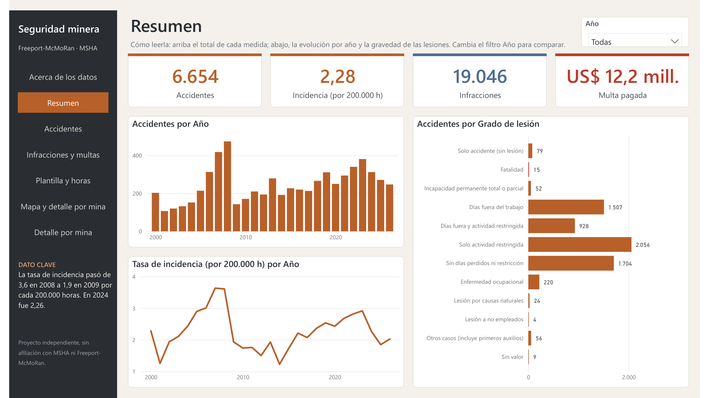
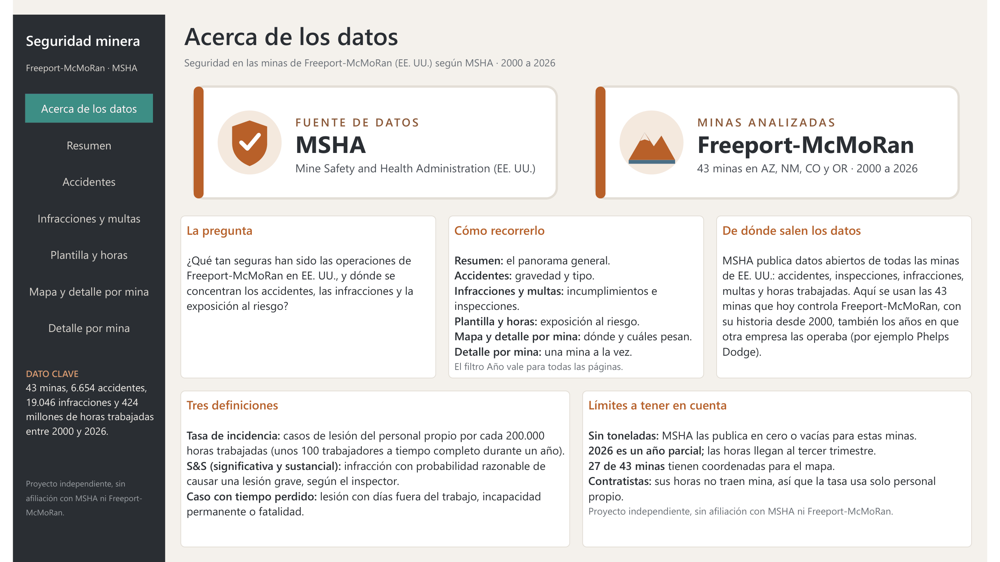
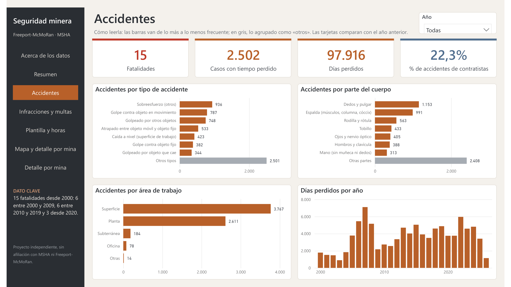
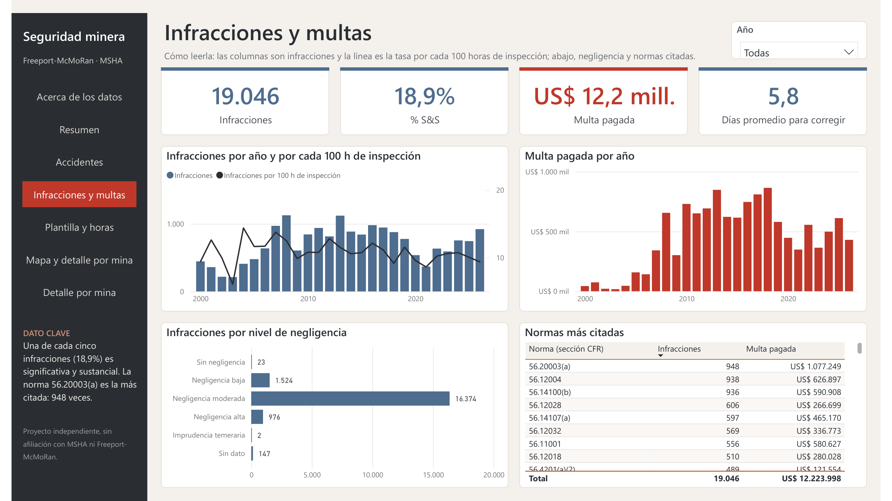
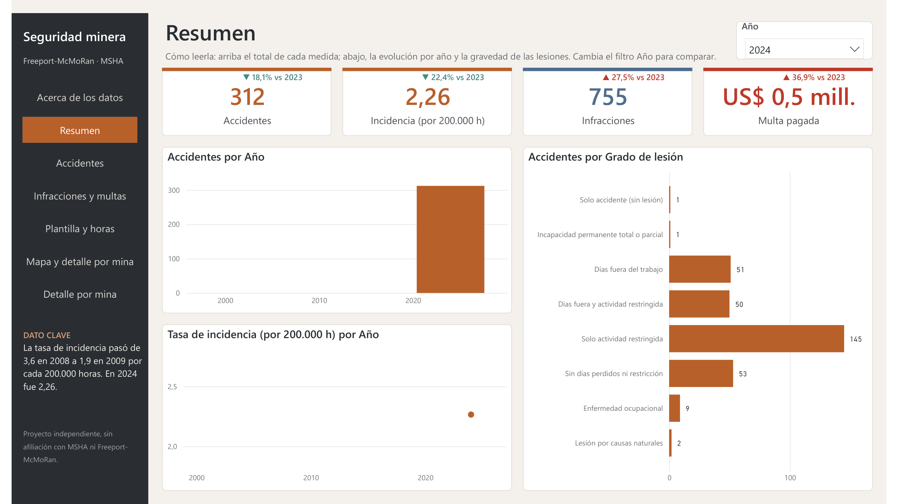

<p align="center"></p>

# Operación y seguridad minera: data warehouse en SQL Server + Power BI

Proyecto reproducible con **datos públicos reales**: horas trabajadas, accidentes, inspecciones, infracciones y multas de las **43 minas de una empresa de cobre** (Freeport-McMoRan, operaciones en EE.UU., 2000 a 2026), publicados por la Mine Safety and Health Administration (MSHA).

> English: [README.md](README.md)

## Qué demuestra

| Habilidad | Dónde verla |
|---|---|
| Modelado dimensional (estrella, dimensión basura, granos) | [`docs/data_model.md`](docs/data_model.md), [`sql/02_dwh_tables.sql`](sql/02_dwh_tables.sql) |
| ETL en T-SQL con staging y carga tipada | [`sql/03_etl.sql`](sql/03_etl.sql) |
| SQL Server en Docker, `BULK INSERT`, índices, vistas y usuario de solo lectura | [`docker-compose.yml`](docker-compose.yml), [`sql/`](sql) |
| Power BI como código (PBIP + TMDL), parámetros, jerarquías y 66 medidas DAX | [`powerbi/`](powerbi), [`docs/dax_measures.md`](docs/dax_measures.md) |
| Perfilado de datos y límites explicados | [`docs/data_profile.md`](docs/data_profile.md), [`docs/decisions.md`](docs/decisions.md) |
| Pruebas automáticas y CI | [`tests/`](tests), [`.github/workflows/ci.yml`](.github/workflows/ci.yml) |

## Informe

Siete páginas: **Acerca de los datos** (fuente, universo, definiciones y límites), **Resumen**, **Accidentes**, **Infracciones y multas**, **Plantilla y horas**, **Mapa y detalle por mina** y **Detalle por mina** (una mina a la vez). Cada página trae una línea de «cómo leerla», un dato clave en la barra lateral y, con un solo año elegido, tarjetas que muestran la variación frente al año anterior. Un menú lateral lleva de una página a otra y un filtro de año se sincroniza entre todas. Un video corto vendrá más adelante.



| | |
|---|---|
|  |  |
|  |  |
|  |  |

Con un solo año elegido (2024) las tarjetas muestran la variación frente al año anterior:



Los nombres de categorías (tipos de accidente, niveles de negligencia, estado de la mina) se traducen al español en el data warehouse; el texto original de MSHA queda en columnas ocultas.

Medida principal: **tasa de incidencia de lesiones por 200.000 horas trabajadas**, solo personal propio y solo en trimestres con horas (ver [decisiones](docs/decisions.md)).

## Inicio rápido (tres comandos)

Requisitos: Docker Desktop, Python 3.11+ y Power BI Desktop (Windows). La primera vez se descargan unos 414 MB de MSHA y la imagen de SQL Server.

```powershell
copy .env.example .env          # edita las dos contraseñas de .env
docker compose up -d --wait
python scripts/run_all.py
```

Luego abre `powerbi/MiningOperationsSafety.pbip`. Guía paso a paso con solución de problemas: [`docs/primera_apertura_power_bi.md`](docs/primera_apertura_power_bi.md).

## Datos y límites

- **MSHA** (datos abiertos del gobierno de EE.UU.). Los archivos cambian cada viernes; el proyecto fija una foto (`data/manifest.json`). La página no declara licencia, por eso **los datos no están en el repositorio**: los scripts los descargan.
- Proyecto independiente, sin afiliación con MSHA ni Freeport-McMoRan.
- La producción de las minas viene en cero o vacía: **no hay toneladas**. Las minas están en EE.UU. 2026 es un año parcial y solo 27 de 43 minas tienen coordenadas.

## Pruebas

```powershell
python -m pytest
python scripts/validate_pbip.py
```

## Licencia

MIT para el código y la documentación ([LICENSE](LICENSE)). Los datos pertenecen a quienes los publican.
