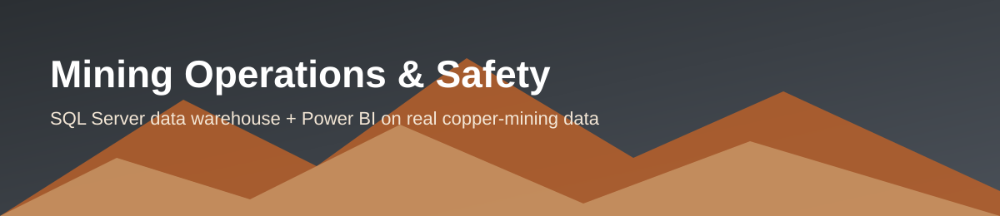
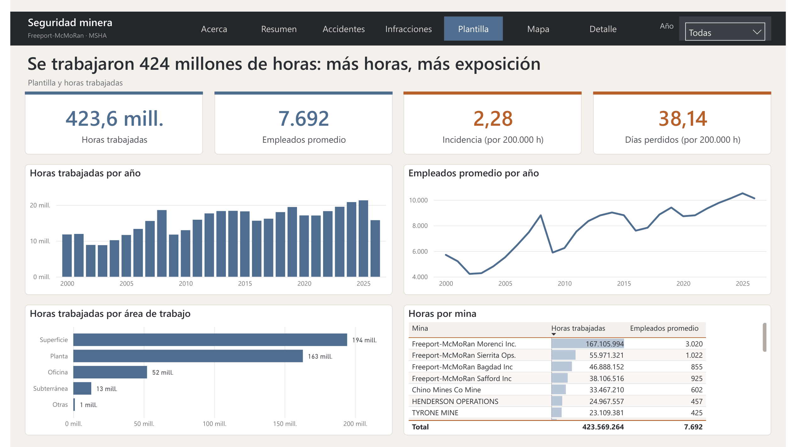
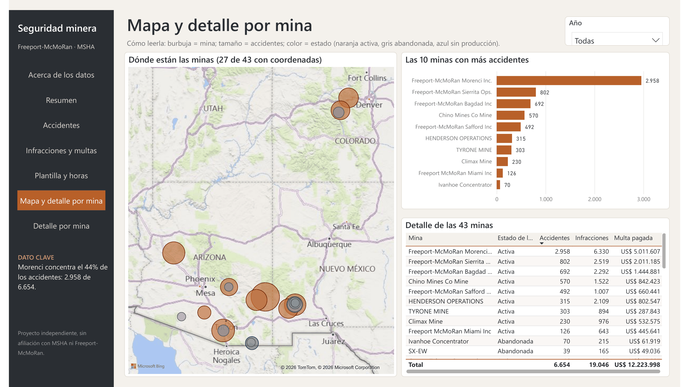
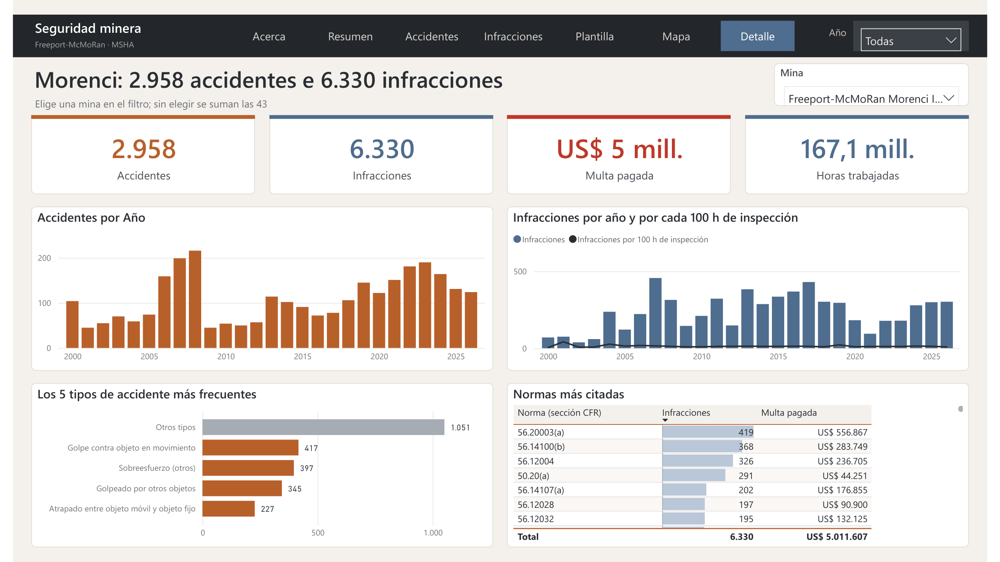

<p align="center"></p>

# Operación y seguridad minera: data warehouse en SQL Server + Power BI

Proyecto reproducible con **datos públicos reales**: horas trabajadas, accidentes, inspecciones, infracciones y multas de las **43 minas de una empresa de cobre** (Freeport-McMoRan, operaciones en EE.UU., 2000 a 2026), publicados por la Mine Safety and Health Administration (MSHA).

> English: [README.md](README.md)

## Qué demuestra

| Habilidad | Dónde verla |
|---|---|
| Modelado dimensional (estrella, dimensión basura, granos) | [`docs/data_model.md`](docs/data_model.md), [`sql/02_dwh_tables.sql`](sql/02_dwh_tables.sql) |
| ETL en T-SQL con staging y carga tipada | [`sql/03_etl.sql`](sql/03_etl.sql) |
| SQL Server en Docker, `BULK INSERT`, índices, vistas y usuario de solo lectura | [`docker-compose.yml`](docker-compose.yml), [`sql/`](sql) |
| Power BI como código (PBIP + TMDL), parámetros, jerarquías y 74 medidas DAX | [`powerbi/`](powerbi), [`docs/dax_measures.md`](docs/dax_measures.md) |
| Perfilado de datos y límites explicados | [`docs/data_profile.md`](docs/data_profile.md), [`docs/decisions.md`](docs/decisions.md) |
| Pruebas automáticas (unitarias y de reconciliación SQL) | [`tests/`](tests), [`.github/workflows/ci.yml`](.github/workflows/ci.yml) |

## Informe

Siete páginas: **Acerca de los datos** (fuente, universo, definiciones y límites), **Resumen**, **Accidentes**, **Infracciones y multas**, **Plantilla y horas**, **Mapa** y **Detalle** (una mina a la vez). Una barra superior oscura trae el navegador de páginas y un filtro de año sincronizado entre todas. El título de cada página es una medida que enuncia el hallazgo y se recalcula con los filtros (por ejemplo *En 2024 la tasa de lesiones fue 2,3, más baja que en 2023 (2,9)*); con un solo año elegido las tarjetas muestran la variación frente al año anterior y los gráficos por año conservan la serie completa. En la página del mapa, un clic en una burbuja o en una fila rellena la ficha de la mina; en *Detalle*, el filtro de mina trae un cuadro de búsqueda (escribe para filtrar). El mapa requiere activar los visuales de mapa en *Archivo → Opciones → Seguridad*. El diseño se probó primero como página HTML interactiva: [`docs/prototipo_visual.html`](docs/prototipo_visual.html) (descárgala y ábrela en un navegador). Un video corto vendrá más adelante.


| | |
|---|---|
|  |  |
|  |  |
|  |  |

Con un solo año elegido (2024) el título, las tarjetas y el ranking lo siguen:


Los nombres de categorías (tipos de accidente, niveles de negligencia, estado de la mina) se traducen al español en el data warehouse; el texto original de MSHA queda en columnas ocultas.

Medida principal: **tasa de incidencia de lesiones por 200.000 horas trabajadas**, solo personal propio y solo en trimestres con horas (ver [decisiones](docs/decisions.md)).

## Qué cuenta el informe

**Fuente y universo.** Los datos los publica **MSHA** (Mine Safety and Health Administration, el regulador minero de EE. UU.). El universo son las **43 minas que hoy controla Freeport-McMoRan** (25 en Arizona, 12 en Nuevo México, 5 en Colorado y 1 en Oregón; 10 activas), con su historia desde 2000, también los años en que otra empresa las operaba. Una sola empresa y una sola fuente: así cada cifra se puede rastrear hasta un archivo de MSHA.

| Página | Pregunta que responde | Cómo leerla | Hallazgo |
|---|---|---|---|
| **Acerca de los datos** | ¿De dónde salen los datos y qué significan? | Fuente, universo, tres definiciones y los límites. | 43 minas, 6.654 accidentes, 19.046 infracciones y 424 millones de horas. |
| **Resumen** | ¿Cuál es el panorama? | Cuatro tarjetas arriba; abajo, la evolución por año y la gravedad. Con un año elegido, cada tarjeta muestra la variación contra el año anterior. | La tasa de incidencia pasó de 3,6 (2008) a 1,9 (2009) por 200.000 horas; en 2024 fue 2,26. |
| **Accidentes** | ¿Qué tan graves y de qué tipo? | Los 5 tipos y partes más frecuentes; en gris, lo agrupado como «otros»; las áreas de trabajo son una sola barra al 100%. | 15 fatalidades desde 2000 (6, 6 y 3 por década); 2.502 casos con tiempo perdido; 22,3% de los accidentes involucra contratistas. |
| **Infracciones y multas** | ¿Qué incumplimientos hubo y cuánto se pagó? | Columnas = infracciones; la línea es la tasa por cada 100 horas de inspección. | 18,9% de las infracciones son significativas y sustanciales; la norma 56.20003(a) se cita 948 veces; multa pagada: US$ 12,2 millones. |
| **Plantilla y horas** | ¿Cuánta exposición al riesgo hubo? | Más horas significa más exposición; la tasa se calcula sobre estas horas. | Superficie y planta suman el 84% de las 424 millones de horas. |
| **Mapa** | ¿Dónde están y cuáles pesan más? | Cada burbuja es una mina: tamaño = accidentes, color = estado. Un clic en una burbuja o fila abre la ficha; los botones filtran por estado. | Morenci concentra el 44% de los accidentes (2.958 de 6.654). |
| **Detalle** | ¿Cómo le fue a una mina en particular? | Escribe o elige una mina en el filtro; sin elegir, se suman las 43. | Ejemplo: Morenci, 2.958 accidentes y 6.330 infracciones. |

Cada cifra sale de una consulta a las vistas `rpt` y cuadra con la tabla de [`docs/dax_measures.md`](docs/dax_measures.md). Para entender el proyecto a fondo: [`docs/guia_para_entender.md`](docs/guia_para_entender.md).

## Inicio rápido (tres comandos)

Requisitos: Docker Desktop, Python 3.11+ y Power BI Desktop (Windows). La primera vez se descargan unos 414 MB de MSHA y la imagen de SQL Server.

```powershell
copy .env.example .env          # edita las dos contraseñas de .env
docker compose up -d --wait
python scripts/run_all.py
```

Luego abre `powerbi/MiningOperationsSafety.pbip`. Guía paso a paso con solución de problemas: [`docs/primera_apertura_power_bi.md`](docs/primera_apertura_power_bi.md).

## Datos y límites

- **MSHA** (datos abiertos del gobierno de EE.UU.). Los archivos cambian cada viernes; el proyecto fija una foto (`data/manifest.json`). La página no declara licencia, por eso **los datos no están en el repositorio**: los scripts los descargan.
- Proyecto independiente, sin afiliación con MSHA ni Freeport-McMoRan.
- La producción de las minas viene en cero o vacía: **no hay toneladas**. Las minas están en EE.UU. 2026 es un año parcial y solo 27 de 43 minas tienen coordenadas.

## Pruebas

```powershell
python -m pytest          # pruebas unitarias + SQL (las SQL necesitan el contenedor en marcha)
python scripts/validate_pbip.py
```

Las pruebas reconcilian filas entre origen, almacén y medidas, y revisan fechas y seguridad; `validate_pbip.py` comprueba que cada columna, relación, medida y campo de visual del proyecto de Power BI exista. Ambas corren en local.

El repositorio incluye además un workflow de GitHub Actions ([`ci.yml`](.github/workflows/ci.yml)) que levanta SQL Server, carga unos fixtures pequeños y corre las mismas comprobaciones sin descargar todos los datos de MSHA. Hoy no se ejecuta: GitHub detiene el trabajo al arrancar por un bloqueo de facturación de la cuenta del autor, no por una prueba que falle.

## Licencia

MIT para el código y la documentación ([LICENSE](LICENSE)). Los datos pertenecen a quienes los publican.
