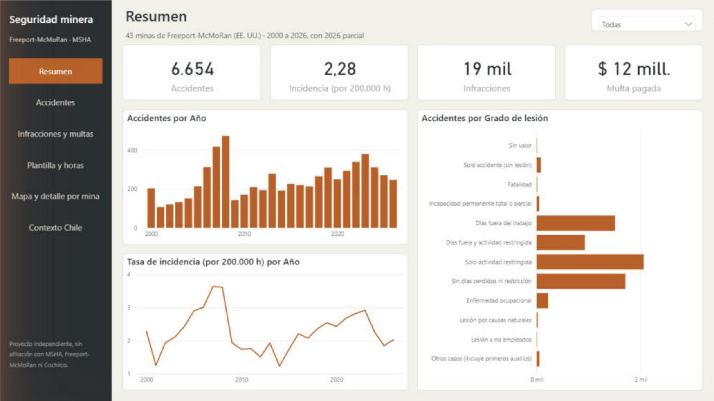
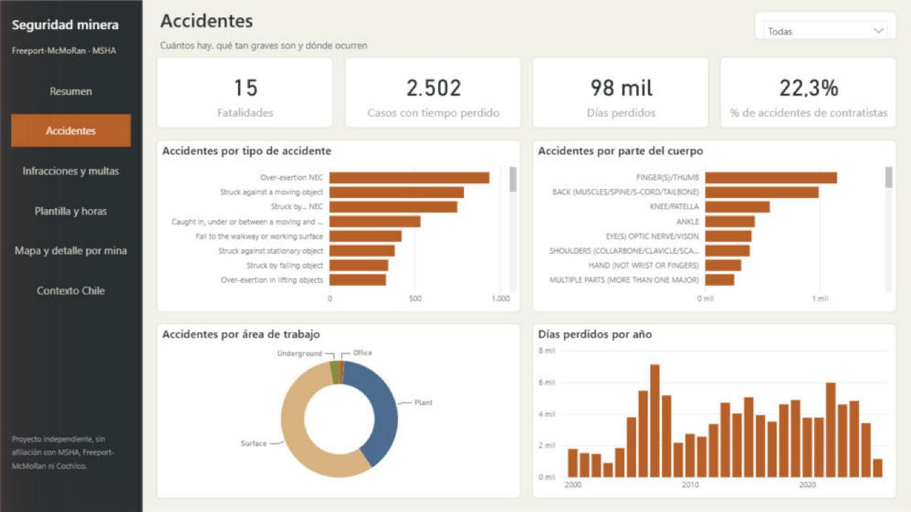
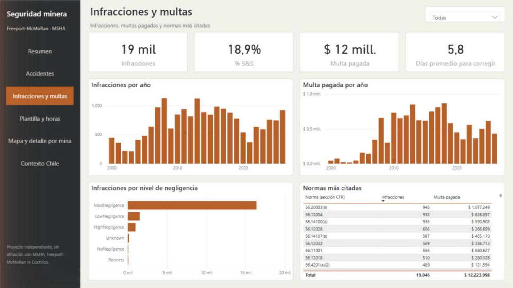
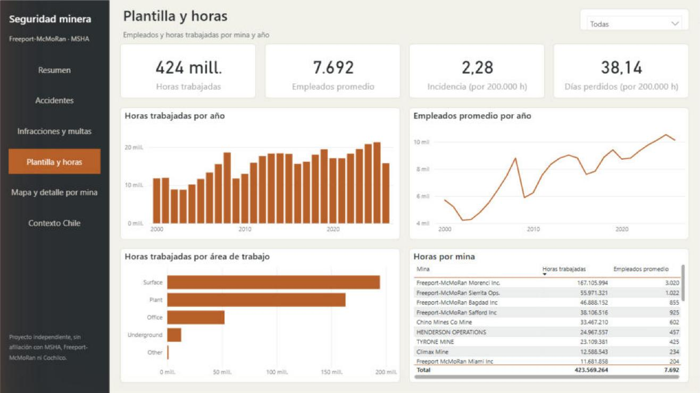
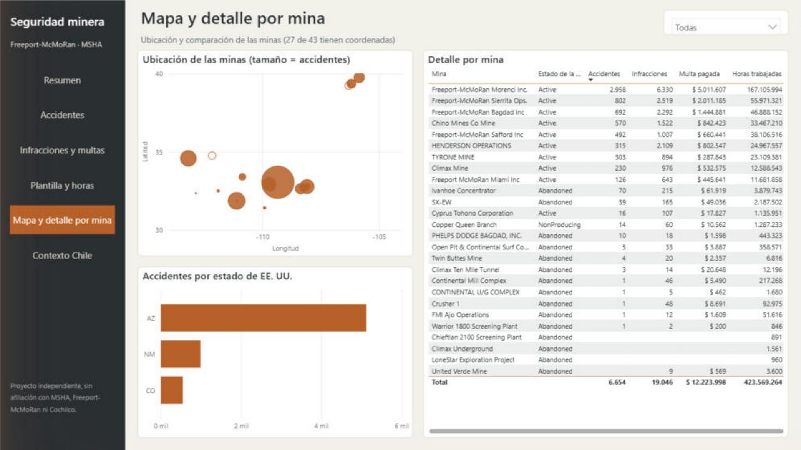
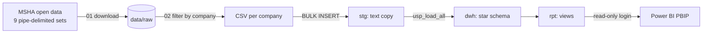

<p align="center"></p>

# Mining Operations & Safety: SQL Server data warehouse + Power BI

[](https://github.com/Katapentakill/mining-operations-safety-powerbi/actions/workflows/ci.yml)


A reproducible analytics project on **real public data**: workforce hours, accidents, inspections, violations and penalties of the **43 mines of one copper company** (Freeport-McMoRan, US operations, 2000 to 2026), published by the U.S. Mine Safety and Health Administration (MSHA).

> Español: [README.es.md](README.es.md)

## What this project demonstrates

| Skill | Where to look |
|---|---|
| Dimensional modeling (star schema, junk dimension, grains) | [`docs/data_model.md`](docs/data_model.md), [`sql/02_dwh_tables.sql`](sql/02_dwh_tables.sql) |
| T-SQL ETL: staging, typed load, `TRY_CONVERT`, reload in one transaction | [`sql/03_etl.sql`](sql/03_etl.sql) |
| SQL Server in Docker, `BULK INSERT`, indexes, reporting views, least-privilege login | [`docker-compose.yml`](docker-compose.yml), [`sql/`](sql) |
| Power BI as code (PBIP + TMDL), parameters, hierarchies, 66 DAX measures | [`powerbi/`](powerbi), [`docs/dax_measures.md`](docs/dax_measures.md) |
| Data profiling and honest limits | [`docs/data_profile.md`](docs/data_profile.md), [`docs/decisions.md`](docs/decisions.md) |
| Automated tests (unit, SQL reconciliation) and CI | [`tests/`](tests), [`.github/workflows/ci.yml`](.github/workflows/ci.yml) |
| Reproducible pipeline (download, filter, load) | [`scripts/`](scripts) |

## Dashboard

Seven report pages: **About the data** (source, scope, definitions and limits), **Summary**, **Accidents**, **Violations and penalties**, **Workforce and hours**, **Map and mine detail** and **Mine detail** (one mine at a time). Each page has a one-line reading guide, a key figure in the sidebar and, with a single year selected, KPI cards that show the change against the previous year. A side menu moves between pages and one year filter is synced across all of them. A short video will be added later.



| | |
|---|---|
|  |  |
|  |  |

Category names (accident types, negligence levels, mine status) are translated to Spanish in the warehouse; the original MSHA text stays in hidden columns.

Headline measure: **injury incidence rate per 200,000 hours worked**, own staff only, computed for quarters that have hours data (see [decisions](docs/decisions.md)).

## Quick start (three commands)

Requirements: Docker Desktop, Python 3.11+, Power BI Desktop (Windows). The first run downloads about 414 MB of MSHA files and the SQL Server image.

```powershell
copy .env.example .env          # then edit the two passwords in .env
docker compose up -d --wait
python scripts/run_all.py
```

Then open `powerbi/MiningOperationsSafety.pbip` in Power BI Desktop:

1. Parameters: `Servidor` = `127.0.0.1,1433` (not `localhost`: Power BI resolves it to the machine's network IPs, where the container does not listen, and the refresh hangs), `Base` = `MiningOpsSafety`.
2. Credentials (Database): user `pbi_reader`, password `PBI_READER_PASSWORD` from your `.env`. If Power BI complains about the certificate, untick *Encrypt connections*.
3. Refresh.

Step by step with troubleshooting (Spanish): [`docs/primera_apertura_power_bi.md`](docs/primera_apertura_power_bi.md).

## How it works



The company is one line in [`config.toml`](config.toml) (`company.controller_name`). Change it and rerun `scripts/run_all.py` to build the same dashboard for another MSHA controller.

## Data and attribution

- **MSHA Open Government Data Sets** ([source](https://arlweb.msha.gov/OpenGovernmentData/OGIMSHA.asp)). Files are replaced every Friday; this project fixes a snapshot (`data/manifest.json` records dates, sizes and checksums). The MSHA page does not state a license, so **no data is stored in this repository**; the scripts download it. `tests/fixtures/` holds a few hundred rows used only by CI.
- This is an independent project. It is not affiliated with MSHA or Freeport-McMoRan.

### Known limits

- MSHA production columns are zero or empty for these mines, so there is **no tonnage**: the analysis is workforce, safety and compliance.
- Mines are in the United States (AZ, NM, CO, OR).
- 2026 is a partial year; workforce hours reach the third quarter, so rates use only quarters with hours.
- Only 27 of the 43 mines have coordinates.

## Tests and CI

```powershell
python -m pytest          # unit tests + SQL assertions (SQL ones need the container running)
python scripts/validate_pbip.py
```

CI starts SQL Server, loads the small fixtures, runs the SQL assertions (row reconciliation, dates, measure totals, security) and checks the Power BI project files. It never downloads the full MSHA data.

## Repository layout

```
config.toml · docker-compose.yml · .env.example
scripts/   download, filter, staging DDL generator, SQL Server loader, run_all
sql/       database, staging, star schema, ETL, views, indexes, security, load scripts
powerbi/   PBIP project (TMDL model + PBIR report with the Copper Mining theme)
assets/    banner and the SVG art of the report (map outline, source badges; `scripts/make_report_art.py`)
tests/     unit tests, SQL assertions, fixtures
docs/      data model, profile, decisions, DAX measures, video script
```

## License

MIT for the code and documentation ([LICENSE](LICENSE)). Data belong to their publishers.
