<p align="center">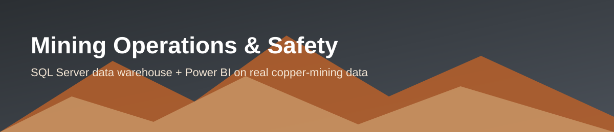</p>

# Mining Operations & Safety: SQL Server data warehouse + Power BI


A reproducible analytics project on **real public data**: workforce hours, accidents, inspections, violations and penalties of the **43 mines of one copper company** (Freeport-McMoRan, US operations, 2000 to 2026), published by the U.S. Mine Safety and Health Administration (MSHA).

> Español: [README.es.md](README.es.md)

## What this project demonstrates

| Skill | Where to look |
|---|---|
| Dimensional modeling (star schema, junk dimension, grains) | [`docs/data_model.md`](docs/data_model.md), [`sql/02_dwh_tables.sql`](sql/02_dwh_tables.sql) |
| T-SQL ETL: staging, typed load, `TRY_CONVERT`, reload in one transaction | [`sql/03_etl.sql`](sql/03_etl.sql) |
| SQL Server in Docker, `BULK INSERT`, indexes, reporting views, least-privilege login | [`docker-compose.yml`](docker-compose.yml), [`sql/`](sql) |
| Power BI as code (PBIP + TMDL), parameters, hierarchies, 74 DAX measures | [`powerbi/`](powerbi), [`docs/dax_measures.md`](docs/dax_measures.md) |
| Data profiling and honest limits | [`docs/data_profile.md`](docs/data_profile.md), [`docs/decisions.md`](docs/decisions.md) |
| Automated tests (unit, SQL reconciliation) | [`tests/`](tests), [`.github/workflows/ci.yml`](.github/workflows/ci.yml) |
| Reproducible pipeline (download, filter, load) | [`scripts/`](scripts) |

## Dashboard

Seven report pages: **About the data** (source, scope, definitions and limits), **Summary**, **Accidents**, **Violations and penalties**, **Workforce and hours**, **Map** and **Detail** (one mine at a time). A dark top bar holds the page navigator and one year filter that is synced across all pages. Each page title is a measure that states the finding and recomputes with the filters (for example *In 2024 the injury rate was 2.3, lower than in 2023 (2.9)*), and with a single year selected the KPI cards show the change against the previous year; the yearly trend charts keep the full series. On the map page a click on a bubble or a table row fills the mine card; on *Detail* the mine slicer has a built-in search box (type to filter). The map needs Power BI's map visuals enabled in *File → Options → Security*. The design was prototyped first as an interactive HTML page: [`docs/prototipo_visual.html`](docs/prototipo_visual.html) (download it and open it in a browser). A 2-minute walkthrough of the report (English subtitles, no voice): [watch on YouTube](https://youtu.be/CGQXQ1UF1GM) ([versión en español](https://youtu.be/kPz3GsVUmrg)). The report as a Power BI template is in the [v1.0.0 release](https://github.com/Katapentakill/mining-operations-safety-powerbi/releases/tag/v1.0.0).

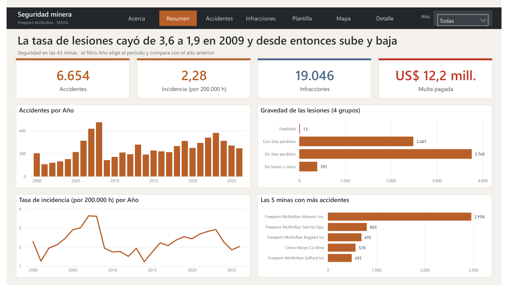

| | |
|---|---|
| 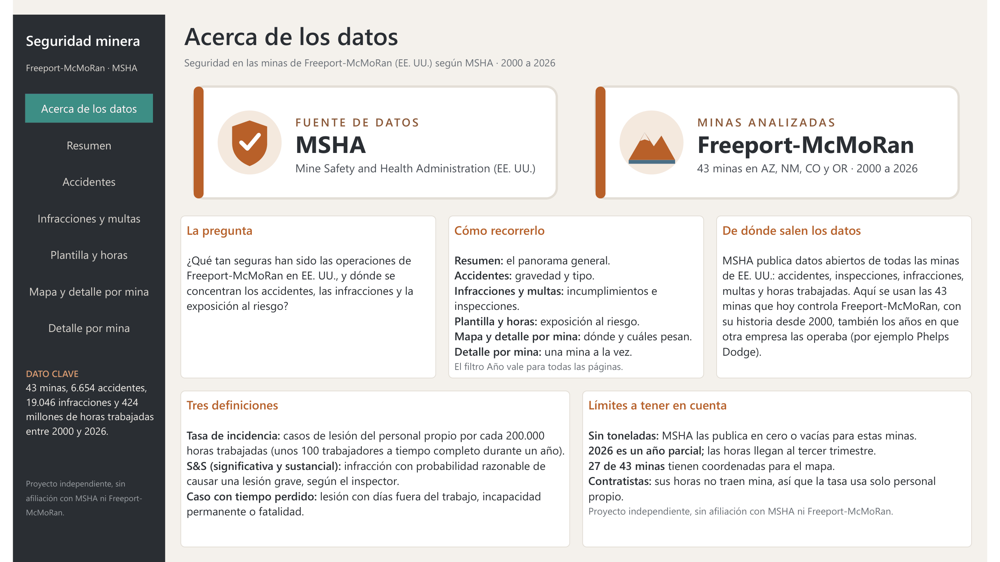 | 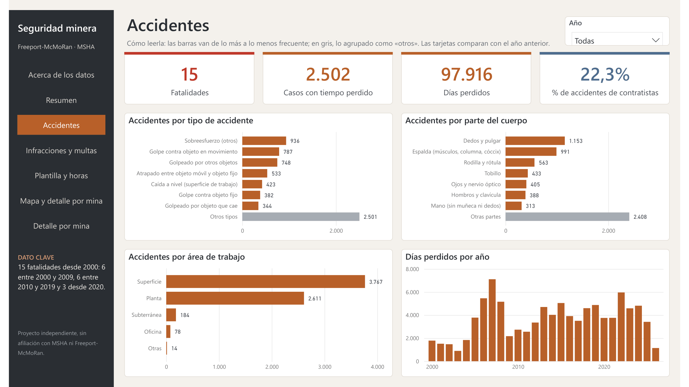 |
| 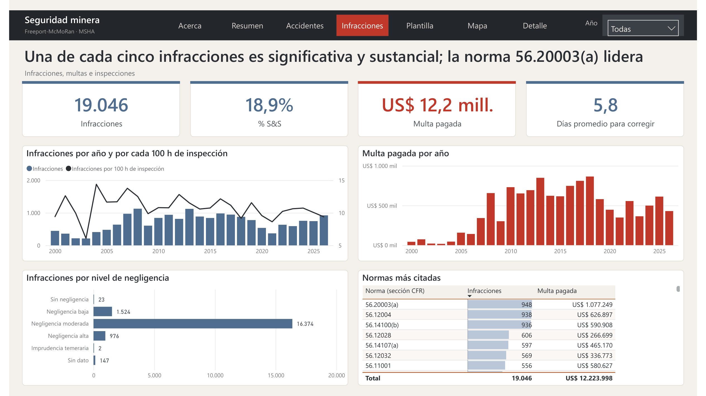 | 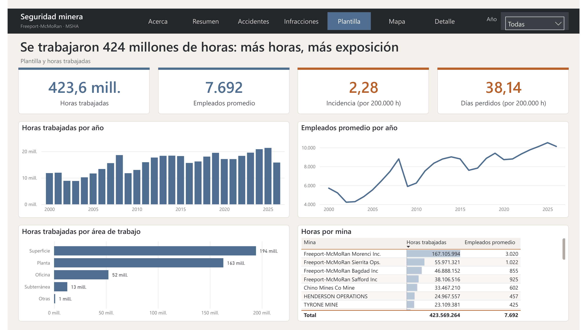 |
| 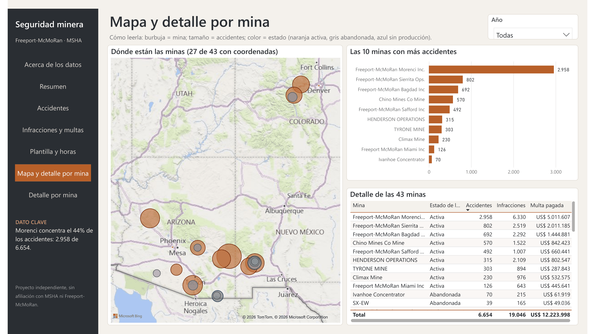 | 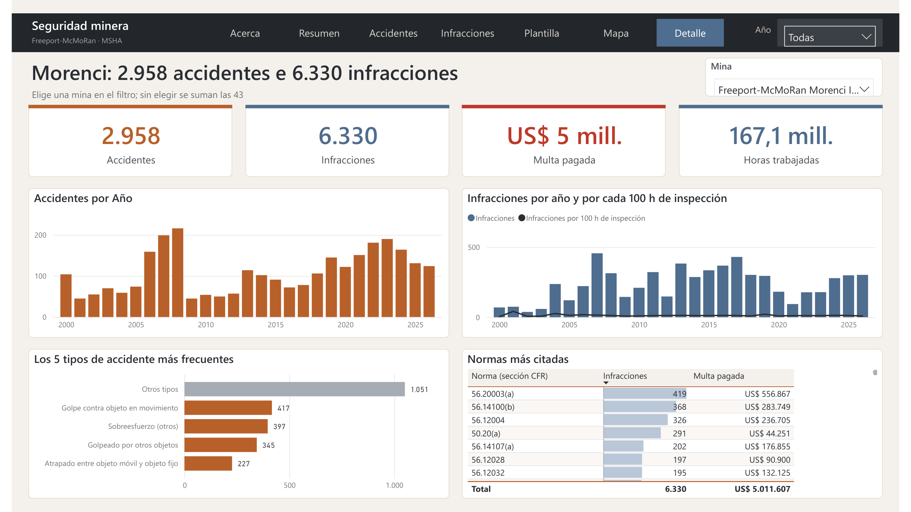 |

With one year selected (2024) the title, the cards and the ranking follow it:

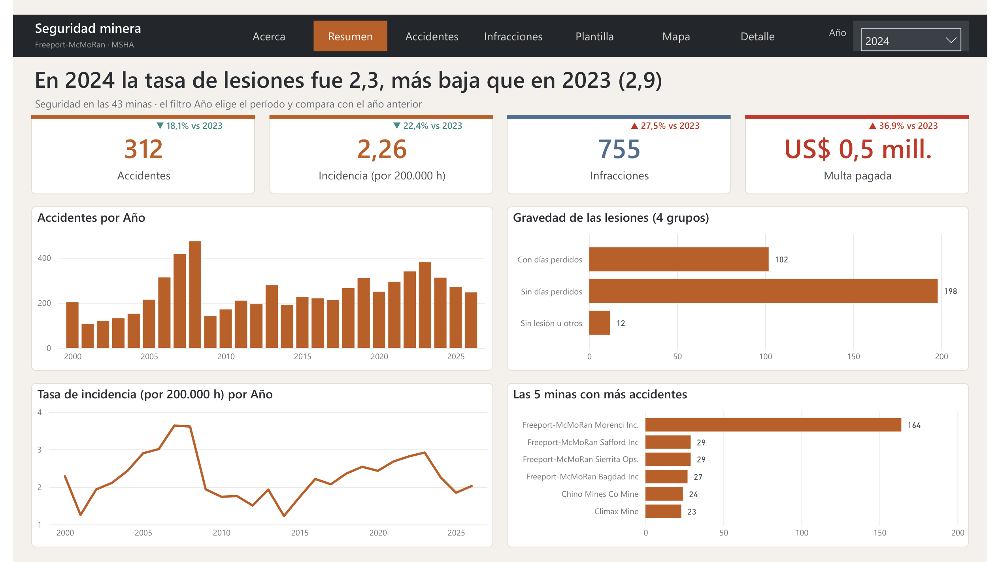

Category names (accident types, negligence levels, mine status) are translated to Spanish in the warehouse; the original MSHA text stays in hidden columns.

Headline measure: **injury incidence rate per 200,000 hours worked**, own staff only, computed for quarters that have hours data (see [decisions](docs/decisions.md)).

## What the report tells

**Source and scope.** The data is published by **MSHA** (the Mine Safety and Health Administration, the US mining regulator). The scope is the **43 mines currently controlled by Freeport-McMoRan** (25 in Arizona, 12 in New Mexico, 5 in Colorado and 1 in Oregon; 10 active), with their history since 2000, including years in which another company ran them. One company and one source: every figure traces back to an MSHA file.

| Page | Question it answers | How to read it | Finding |
|---|---|---|---|
| **About the data** | Where does the data come from and what does it mean? | Source, scope, three definitions and the limits. | 43 mines, 6,654 accidents, 19,046 violations and 424 million hours. |
| **Summary** | What is the overall picture? | Four cards on top; below, the trend by year and the severity. With one year selected, each card shows the change against the previous year. | The incidence rate fell from 3.6 (2008) to 1.9 (2009) per 200,000 hours; in 2024 it was 2.26. |
| **Accidents** | How severe and of what kind? | The 5 most frequent types and body parts; gray is what is grouped as "other"; work areas are one 100% bar. | 15 fatalities since 2000 (6, 6 and 3 per decade); 2,502 lost-time cases; 22.3% of accidents involve contractors. |
| **Violations and penalties** | What was breached and how much was paid? | Columns = violations; the line is the rate per 100 inspection hours. | 18.9% of violations are significant and substantial; standard 56.20003(a) is cited 948 times; penalties paid: US$ 12.2 million. |
| **Workforce and hours** | How much exposure to risk was there? | More hours means more exposure; the rate is computed on these hours. | Surface and plant add up to 84% of the 424 million hours. |
| **Map** | Where are the mines and which weigh most? | Each bubble is a mine: size = accidents, color = status. Click a bubble or a row for the mine card; the chips filter by status. | Morenci holds 44% of the accidents (2,958 of 6,654). |
| **Detail** | How did one particular mine do? | Type or pick a mine in the filter; with none picked, the 43 are added up. | Example: Morenci, 2,958 accidents and 6,330 violations. |

Every figure comes from a query against the `rpt` views and matches the table in [`docs/dax_measures.md`](docs/dax_measures.md). To understand the project in depth (Spanish): [`docs/guia_para_entender.md`](docs/guia_para_entender.md).

## Quick start (three commands)

Requirements: Docker Desktop, Python 3.11+, Power BI Desktop (Windows). The first run downloads about 414 MB of MSHA files and the SQL Server image.

```powershell
copy .env.example .env          # then edit the two passwords in .env
docker compose up -d --wait
python scripts/run_all.py
```

Then open `powerbi/MiningOperationsSafety.pbip` in Power BI Desktop:

1. Parameters: `Servidor` = `127.0.0.1,1433` (not `localhost`: Power BI resolves it to the machine's network IPs, where the container does not listen, and the refresh hangs), `Base` = `MiningOpsSafety`.
2. Credentials (Database): user `pbi_reader`, password `PBI_READER_PASSWORD` from your `.env`. If Power BI complains about the certificate, untick *Encrypt connections*.
3. Refresh.

Step by step with troubleshooting (Spanish): [`docs/primera_apertura_power_bi.md`](docs/primera_apertura_power_bi.md).

## How it works

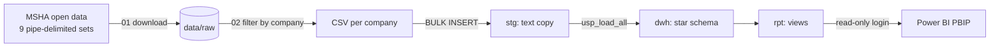

The company is one line in [`config.toml`](config.toml) (`company.controller_name`). Change it and rerun `scripts/run_all.py` to build the same dashboard for another MSHA controller.

## Data and attribution

- **MSHA Open Government Data Sets** ([source](https://arlweb.msha.gov/OpenGovernmentData/OGIMSHA.asp)). Files are replaced every Friday; this project fixes a snapshot (`data/manifest.json` records dates, sizes and checksums). The MSHA page does not state a license, so **no data is stored in this repository**; the scripts download it. `tests/fixtures/` holds a few hundred rows used only by the CI workflow.
- This is an independent project. It is not affiliated with MSHA or Freeport-McMoRan.

### Known limits

- MSHA production columns are zero or empty for these mines, so there is **no tonnage**: the analysis is workforce, safety and compliance.
- Mines are in the United States (AZ, NM, CO, OR).
- 2026 is a partial year; workforce hours reach the third quarter, so rates use only quarters with hours.
- Only 27 of the 43 mines have coordinates.

## Tests

```powershell
python -m pytest          # unit tests + SQL assertions (SQL ones need the container running)
python scripts/validate_pbip.py
```

The suite reconciles row counts between source, warehouse and measures, checks dates and security, and `validate_pbip.py` checks that every column, relationship, measure and visual field of the Power BI project exists. Both run locally.

The repository also includes a GitHub Actions workflow ([`ci.yml`](.github/workflows/ci.yml)) that starts SQL Server, loads the small fixtures and runs the same checks without downloading the full MSHA data. It is not running at the moment: GitHub blocks the job at startup because of a billing lock on the owner's account, not because of a failing test.

## Excel companion

The same aggregated figures also feed an Excel workbook: a dashboard with live formulas and native charts, a mine table with sparklines, and PivotTables with slicers. It is generated from the database by [`excel/build_excel.py`](excel/build_excel.py); see [`excel/README.md`](excel/README.md).

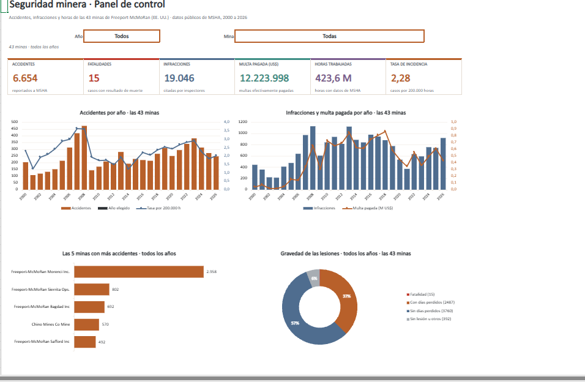

## Repository layout

```
config.toml · docker-compose.yml · .env.example
scripts/   download, filter, staging DDL generator, SQL Server loader, run_all
sql/       database, staging, star schema, ETL, views, indexes, security, load scripts
powerbi/   PBIP project (TMDL model + PBIR report with the Copper Mining theme)
excel/     Excel companion: aggregate queries, workbook generator, screenshots (see excel/README.md)
assets/    banner and the SVG art of the report (map outline, source badges; `scripts/make_report_art.py`)
tests/     unit tests, SQL assertions, fixtures
docs/      data model, profile, decisions, DAX measures, video script, interactive HTML prototype
```

## License

MIT for the code and documentation ([LICENSE](LICENSE)). Data belong to their publishers.
