# Data model

Star schema in schema `dwh`; Power BI reads the same names through views in schema `rpt`.

```mermaid
erDiagram
    dim_date ||--o{ fact_accident : date_key
    dim_mine ||--o{ fact_accident : mine_key
    dim_company ||--o{ fact_accident : company_key
    dim_work_area ||--o{ fact_accident : work_area_key
    dim_injury_degree ||--o{ fact_accident : injury_degree_key
    dim_accident_type ||--o{ fact_accident : accident_type_key
    dim_occupation ||--o{ fact_accident : occupation_key
    dim_body_part ||--o{ fact_accident : body_part_key
    dim_nature_injury ||--o{ fact_accident : nature_injury_key
    dim_activity ||--o{ fact_accident : activity_key
    dim_equipment ||--o{ fact_accident : equipment_key
    fact_accident ||--|| accident_narrative : accident_key

    dim_date ||--o{ fact_violation : date_key
    dim_mine ||--o{ fact_violation : mine_key
    dim_company ||--o{ fact_violation : company_key
    dim_standard ||--o{ fact_violation : standard_key
    dim_violation_profile ||--o{ fact_violation : violation_profile_key

    dim_date ||--o{ fact_inspection : date_key
    dim_mine ||--o{ fact_inspection : mine_key
    dim_company ||--o{ fact_inspection : company_key

    dim_date ||--o{ fact_workforce : date_key
    dim_mine ||--o{ fact_workforce : mine_key
    dim_work_area ||--o{ fact_workforce : work_area_key

    dim_date ||--o{ fact_cu_price_month : date_key
    dim_date ||--o{ fact_cu_production_month : date_key
```

## Grains

| Table | One row is |
|---|---|
| `fact_accident` | one reported accident (`DOCUMENT_NO`) |
| `fact_violation` | one violation, with its penalty on the same row (`has_assessment` tells if a penalty exists) |
| `fact_inspection` | one inspection event |
| `fact_workforce` | one mine, work area and calendar quarter |
| `fact_cu_price_month` | one month (Chile context) |
| `fact_cu_production_month` | one month and mine or company column (Chile context) |

## Dimensions worth knowing

- `dim_company` is the **controller (parent company) at the time of the event**, not the current one. `is_target_company` marks the company this snapshot was built for, so the report can separate years in which a mine belonged to someone else.
- `dim_violation_profile` is a junk dimension that groups six low-cardinality attributes (significant and substantial, negligence, likelihood, expected injury, citation type, Mine Act section) into one table.
- `dim_injury_degree` carries three flags used by the measures: `is_fatality`, `is_lost_time` (degrees 01 to 04) and `counts_as_injury` (degrees 01 to 06).
- Every code dimension has a `?` member, so a missing code never drops a fact row.
- `dim_date` runs from 2000-01-01 to the end of the current year, with an MSHA fiscal year (starts 1 October) and `has_hours_data`, true for quarters up to the last one with workforce hours.

## Layers

| Schema | Content |
|---|---|
| `stg` | text copy of each CSV (generated DDL in `sql/01_staging.sql`) |
| `dwh` | typed star schema, rebuilt by `dwh.usp_load_all` in one transaction |
| `rpt` | one view per `dwh` table; the only schema the `pbi_reader` login can read |

The Chile context tables are not related to `dim_mine`: they cover every Chilean company.
