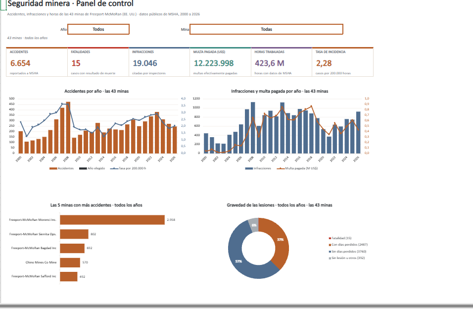
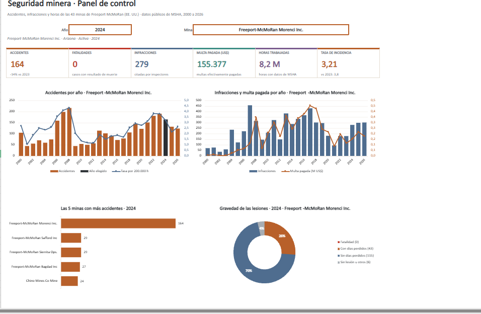
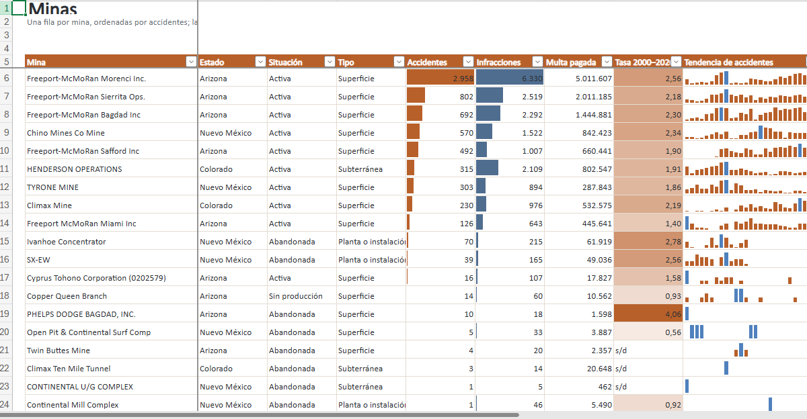
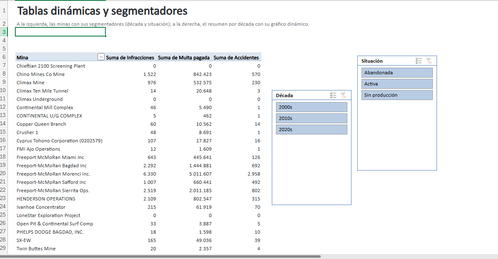

# Complemento en Excel: panel de seguridad minera

> English: [README.md](README.md)

Un libro de Excel hecho con las mismas cifras agregadas de MSHA del informe de Power BI: un panel con fórmulas vivas y gráficos nativos, una tabla de minas con minigráficos y tablas dinámicas con segmentadores. El generador es código (Python + SQL), así que el libro se reconstruye desde la base de datos.



Al elegir **2024** y **Freeport-McMoRan Morenci Inc.** en las dos listas, se recalculan las tarjetas y los cuatro gráficos (comprobado en Excel para la web: 164 accidentes, −14 % frente a 2023, tasa de incidencia 3,21):



## Qué trae el libro

| Hoja | Qué muestra | Técnicas de Excel |
|---|---|---|
| **Panel** | 6 tarjetas, 4 gráficos nativos (columnas con el año elegido resaltado y la tasa en eje secundario, infracciones y multa, top 5 de minas, anillo de gravedad); listas de año y mina | Listas de validación, nombres definidos, `SUMIFS`, `XLOOKUP`, `INDEX`/`MATCH`/`LARGE`, `IFERROR`, gráficos combinados, títulos que siguen la selección |
| **Minas** | Las 43 minas con estado, situación, tipo, accidentes, infracciones, multa pagada, tasa y tendencia por año | `XLOOKUP`, barras de datos, escala de color, minigráficos, filtros, paneles inmovilizados |
| **Datos** | Tres tablas con nombre (`t_anio_mina`, `t_gravedad`, `t_minas`), solo cifras agregadas | Tablas de Excel y referencias estructuradas |
| **Pivote** | Dos tablas dinámicas (por mina y por década), dos segmentadores (década y situación de la mina) y un gráfico dinámico | Tablas dinámicas, segmentadores, gráfico dinámico (agregados en Excel para la web) |
| **Cómo está hecho** | Qué técnica se usa en cada parte | |




## Reconstruir

```powershell
docker compose up -d --wait          # SQL Server con los datos cargados
python excel/build_excel.py          # escribe excel/MiningSafety_Excel_base.xlsx
python excel/build_excel.py --anio 2024 --mina "Freeport-McMoRan Morenci Inc."   # abre con una selección
```

`excel/queries.sql` trae las cuatro consultas agregadas (leen solo las vistas `rpt`); `excel/datos.py` las ejecuta en el contenedor y `excel/build_excel.py` escribe el libro con XlsxWriter, dejando junto a cada fórmula el resultado calculado con pandas para que los visores que no recalculan muestren los números correctos. El `MiningSafety_Excel.xlsx` publicado es ese libro base más las tablas dinámicas, los segmentadores y el gráfico dinámico, agregados en Excel para la web ([`PASOS_MANUALES.md`](PASOS_MANUALES.md)); va como archivo de un release y no se guarda en git.

## Cómo se comprobó

- Los agregados cuadran con los totales de control de la base (6.654 accidentes, 15 fatalidades, 19.046 infracciones, US$ 12.223.998 pagados, tasa 2024 de 2,26 con 236 casos y 20.839.543 horas); ver `tests/unit/test_excel_build.py`.
- LibreOffice recalculó las fórmulas (recálculo forzado, sin usar los valores guardados) en cuatro selecciones y se compararon con pandas: todas iguales, sin errores de fórmula.
- Abierto y recalculado en Excel para la web con un año y una mina elegidos.

## Límites

- Solo van cifras agregadas: MSHA no declara licencia para sus datos, así que no se publican las filas originales.
- La tasa por mina muestra `s/d` con menos de 50.000 horas, donde un solo caso la distorsiona.
- No se pudo usar Power Query: la cuenta de Excel para la web usada aquí no muestra el comando *Obtener datos* (el panel *Consultas y conexiones* lista 0 consultas y no permite crear una). El libro no lo declara.
- Dos minas distintas de MSHA comparten nombre («Cyprus Tohono Corporation»); se distinguen con el código de la mina.
