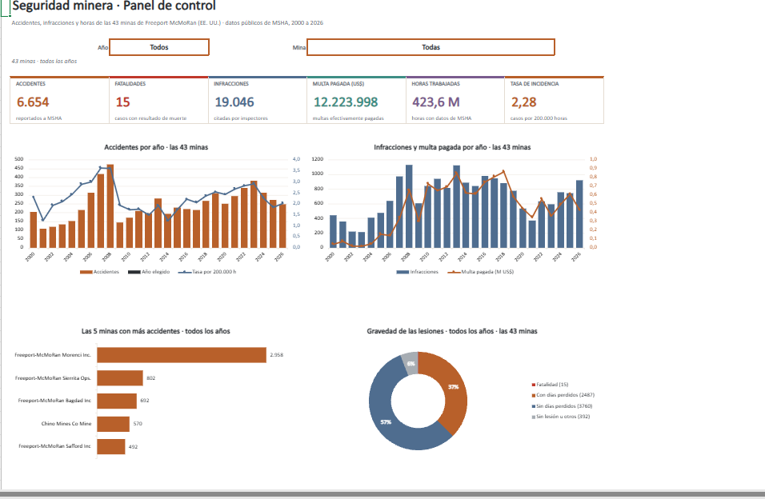
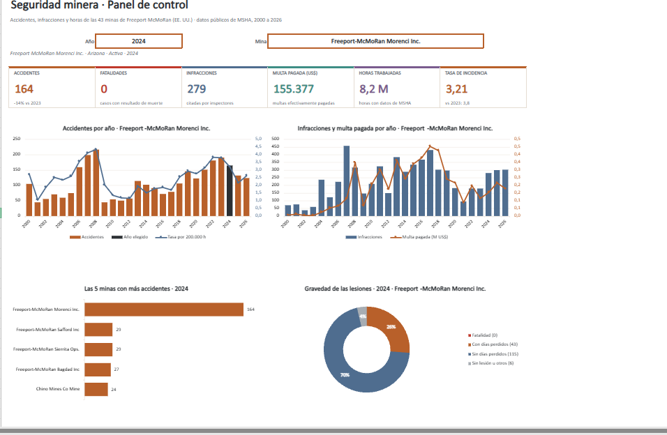
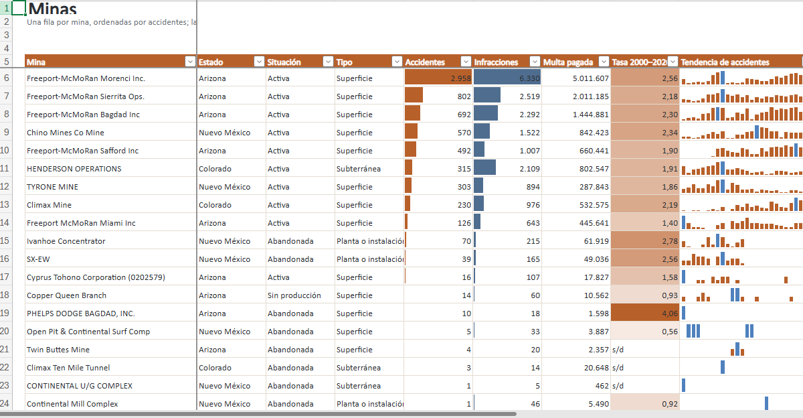
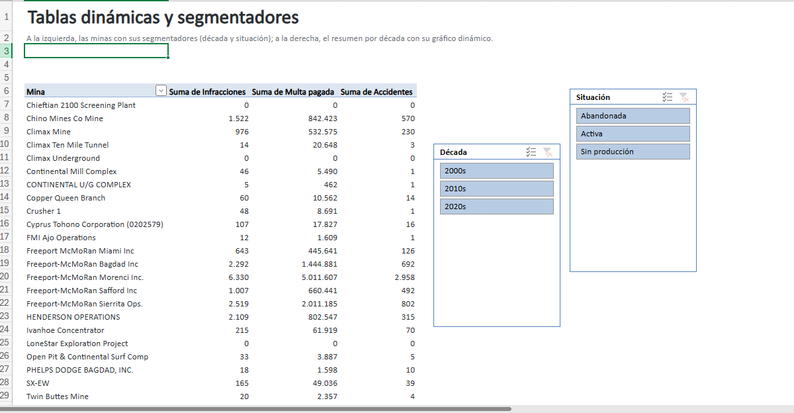

# Excel companion: mining safety dashboard

> Español: [README.es.md](README.es.md)

An Excel workbook built on the same aggregated MSHA figures as the Power BI report: a dashboard with live formulas and native charts, a mine table with sparklines, and PivotTables with slicers. The generator is code (Python + SQL), so the workbook can be rebuilt from the database.



Choosing **2024** and **Freeport-McMoRan Morenci Inc.** in the two drop-downs recalculates the cards and the four charts (checked in Excel for the web: 164 accidents, -14 % vs 2023, incidence rate 3.21):



## What is in the workbook

| Sheet | What it shows | Excel techniques |
|---|---|---|
| **Panel** | 6 cards, 4 native charts (columns with the selected year highlighted + rate on a secondary axis, violations + penalty, top 5 mines, severity doughnut); year and mine drop-downs | Data validation lists, defined names, `SUMIFS`, `XLOOKUP`, `INDEX`/`MATCH`/`LARGE`, `IFERROR`, combo charts, titles that follow the selection |
| **Minas** | The 43 mines with state, status, type, accidents, violations, penalty paid, rate and a yearly trend | `XLOOKUP`, data bars, colour scale, sparklines, filters, freeze panes |
| **Datos** | Three named tables (`t_anio_mina`, `t_gravedad`, `t_minas`), aggregates only | Excel Tables and structured references |
| **Pivote** | Two PivotTables (by mine, by decade), two slicers (decade, mine status) and a PivotChart | PivotTables, slicers, PivotChart (added inside Excel for the web) |
| **Cómo está hecho** | Which technique is used where | |




## Rebuild

```powershell
docker compose up -d --wait          # SQL Server with the loaded data
python excel/build_excel.py          # writes excel/MiningSafety_Excel_base.xlsx
python excel/build_excel.py --anio 2024 --mina "Freeport-McMoRan Morenci Inc."   # opens with a selection
```

`excel/queries.sql` holds the four aggregate queries (they read only the `rpt` views). `excel/datos.py` runs them in the container and `excel/build_excel.py` writes the workbook with XlsxWriter, passing the pandas result next to every formula so viewers that do not recalculate still show the right numbers. The published `MiningSafety_Excel.xlsx` is that base workbook plus the PivotTables, slicers and PivotChart, added in Excel for the web ([`PASOS_MANUALES.md`](PASOS_MANUALES.md)); it is a release asset and is not stored in git.

## How it was checked

- The aggregates reconcile with the database control totals (6,654 accidents, 15 fatalities, 19,046 violations, US$ 12,223,998 paid, 2024 rate 2.26 from 236 cases and 20,839,543 hours); see `tests/unit/test_excel_build.py`.
- The formulas were recalculated by LibreOffice (forced recalculation, ignoring the stored values) for four selections and compared with pandas: all equal, no formula errors.
- Opened and recalculated in Excel for the web with a year and a mine selected.

## Limits

- Only aggregates are included: MSHA states no licence for its data, so raw rows are not published.
- The per-mine rate shows `s/d` below 50,000 hours, where a single case would distort it.
- Power Query could not be used: the Excel for the web account used here shows no *Get data* command (the *Queries and connections* pane lists 0 queries and cannot create one). Nothing in the workbook claims it.
- Two different MSHA mines share a name ("Cyprus Tohono Corporation"); they are told apart by the mine id.
